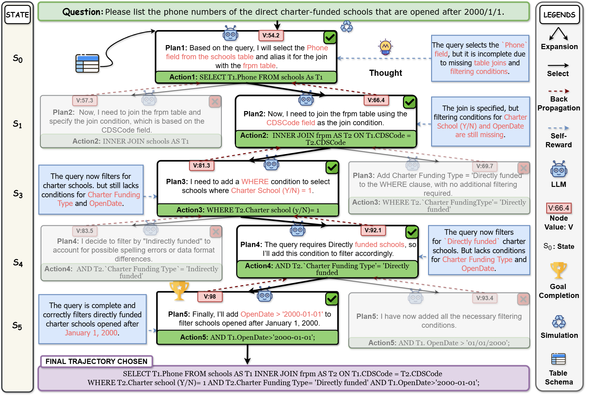

# SQL-o1: Automatic Text-to-SQL Program Synthesis via Self-Reward Heuristic Search

## Overview




## Introduction

PyTorch implementation for [SQL-o1: Automatic Text-to-SQL Program Synthesis via Self-Reward Heuristic Search](https://arxiv.org/abs/2502.11741).

## Dependence
```bash
conda create -n SQL-o1 python=3.11
conda activate SQL-o1
pip install torch==2.3.0
pip install -r requirements.txt
```

## Data Preparation (Schema-Aware Data + PSG)
### 1.1 Please place the downloaded dataset files in the directory structure as shown below.
```bash
SQL-o1/
└──dataset/
    ├── spider/                  
        ├── train.json
        ├── tables.json
        ├── Spider_DK.json
        ├── spider-realistic.json
        ├── dev_syn.json
        ├── ...
        ├── dev.json
        ├── test.json
        ├── test_database/
        └── database/ 
    ├── bird/                 
        ├── train/
            ├── train.json
            ├── train_tables.json
            ├── ...
            └── train_databases/
        ├── dev/                    
            ├── dev.json                   
            ├── dev_tables.json
            ├── ...    
            └── dev_databases/  
                                     
```

### 1.2 Build schema-aware data and mine PSG failures
```bash
# Schema-aware SFT pairs
python preprocess_data.py --dataset spider --mode train --LLM_model meta-llama/Meta-Llama-3-8B-Instruct --data_path /data/vda/dataset --output_path ./dataset
python preprocess_data.py --dataset bird --mode train --LLM_model meta-llama/Meta-Llama-3-8B-Instruct --data_path /data/vda/dataset --output_path ./dataset

# PSG failure pairs (repeat for each backbone with a unique --tag)
python preprocess_data.py --dataset spider --mode train --PSG --tag SQL-o1_llama3 --LLM_model meta-llama/Meta-Llama-3-8B-Instruct --data_path /data/vda/dataset --output_path ./dataset
```

Run the PSG command for each backbone with a unique `--tag`, then merge the
schema-aware and deduplicated PSG pairs (22.7% of the final cold-start set):
```bash
python build_cold_start_data.py \
  --schema_data ./dataset/SQL-o1_spider_train_0.json ./dataset/SQL-o1_bird_train_0.json \
  --failure_data ./dataset/*_psg.json \
  --output_file ./dataset/sql_o1_cold_start.json \
  --psg_ratio 0.227 --max_psg_examples 4826
```

## SFT for Model
Train the model using the manuscript settings (LoRA, batch size 32, learning
rate `1e-5`, cosine decay, 2 epochs, gradient clipping at 1.0). Edit the model
path/template when using Qwen2.5.

```bash
FORCE_TORCHRUN=1 llamafactory-cli train configs/sql_o1_lora_sft.yaml
```

```bash
CUDA_VISIBLE_DEVICES=0 llamafactory-cli export --model_name_or_path /home/huggingface/meta-llama/Llama-3-8B-Instruct --adapter_name_or_path ./saves/sql_o1/lora/sft --template llama3 --finetuning_type lora --export_dir /data/vda/llama3_merge/ --export_size 2 --export_legacy_format False
```

## MCTS Search for Model


### 2.1 Prepare the test data by ensuring it is properly formatted
```bash
python preprocess_data.py --dataset spider --mode dev --LLM_model meta-llama/Meta-Llama-3-8B-Instruct --data_path /data/vda/dataset --output_path ./dataset
python preprocess_data.py --dataset bird --mode dev --LLM_model meta-llama/Meta-Llama-3-8B-Instruct --data_path /data/vda/dataset --output_path ./dataset
```
### 2.2 Start LLM API for Models
```bash
CUDA_VISIBLE_DEVICES=0 API_PORT=8000 nohup python src/llm_api.py --model_name_or_path  /data/vda/llama3_merge/  --template llama3 --temperature 0.9 >> result_llm_api_0.log 2>&1 &
```
### 2.3 Revised MCTS search
```bash
python _run_explore.py \
  --task_name bird \
  --dataset_root ./dataset \
  --input_file ./dataset/SQL-o1_bird_dev_db_id_0.json \
  --output_file ./mcts_results/bird_mcts_dev.json \
  --pruning_transition 6

python validation_results.py --json_path ./mcts_results/bird_mcts_dev.json --db_root_path ./dataset/bird/dev/dev_databases --output_file bird_dev.sql
```

### 2.4 Close API of Model & Test the quality of the generated .sql file.
```bash
bash kill_llm_api.sh
```

## BibTex
If this work contributes to your research, please cite it as follows:
```bash
@misc{lyu2025sqlo1selfrewardheuristicdynamic,
      title={SQL-o1: Automatic Text-to-SQL Program Synthesis via Self-Reward Heuristic Search},
      author={Shuai Lyu and Haoran Luo and Zhonghong Ou and Yifan Zhu and Xiaoran Shang and Yang Qin and Meina Song},
      year={2025},
      eprint={2502.11741},
      archivePrefix={arXiv},
      primaryClass={cs.DB},
      url={https://arxiv.org/abs/2502.11741}, 
}
```
For further questions, please contact: [Lxb_savior@bupt.edu.cn](Lxb_savior@bupt.edu.cn)
## Acknowledgement
This repository builds upon [LLM-Reasoners](https://github.com/maitrix-org/llm-reasoners) and [LLaMA-Factory](https://github.com/hiyouga/LLaMA-Factory). We appreciate their excellent work.
